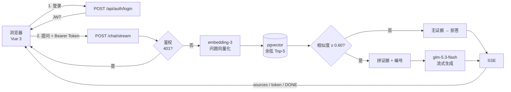

# 售后知识 Copilot

面向电商售后场景的 RAG 问答系统：**检索证据 → 阈值过滤 → 大模型流式生成 → 引用可溯源**，并配套 55 条评测集把"效果到底行不行"变成可复现的数字。

前端 Vue 3 + TypeScript，后端 FastAPI + PostgreSQL/pgvector，模型走智谱 GLM（`embedding-3` 向量化 + `glm-5.3-flash` 生成）。

---

## 为什么做这个项目

通用大模型能聊售后，但会**编造**退款时效、开票规则这类业务事实。企业真正需要的是：回答有出处、没依据时敢说不知道、效果可度量。

这个项目就是一个小而完整的答案：

- **有出处**：每条回答标注 `[1] [2]` 引用编号，前端同步展示被引用的原文片段与相似度；
- **敢拒答**：相似度阈值 + system prompt 双保险，资料里没有的就明确拒答，不硬编；
- **可度量**：55 条评测集分正例/边界/对抗三类，检索层与端到端两层指标都能一条命令复现；
- **有取舍**：混合检索实测**不如**纯向量，就没上线——数据说了算，不为了好看而堆技术。

## 功能

| 模块 | 说明 |
|---|---|
| 登录认证 | JWT 无状态登录，bcrypt 存密码，登录态持久化（记住我 → localStorage / 否则 sessionStorage） |
| 运营概览 | 数据看板页面（**当前为前端演示数据**，见[已知限制](#已知限制)） |
| 智能客服 | 悬浮对话框，SSE 流式输出，支持中途停止、快捷问题、引用来源展开 |
| RAG 问答 | 向量检索 Top-5 → 阈值过滤 → 拼证据 → 流式生成，无依据自动拒答 |
| 评测脚本 | 检索层（Recall@5 / MRR）与端到端（命中率 / 引用率 / 拒答率 / 伪证据数） |

## 技术栈

| 层 | 选型 |
|---|---|
| 前端 | Vue 3.5 · TypeScript · Vite · Vue Router · Pinia · Tailwind CSS 4 · axios |
| 后端 | FastAPI · Pydantic v2 · uvicorn · psycopg3（同步连接池） |
| 数据 | PostgreSQL 16 + pgvector（HNSW 余弦索引） |
| 模型 | 智谱 GLM：`embedding-3`（1024 维） + `glm-5.3-flash`（流式对话） |
| 认证 | PyJWT（HS256） + bcrypt |

## 架构



一次请求的 SSE 事件顺序：

```
data: {"sources":[{"index":1,"content":"...","similarity":0.671}]}   ← 先给出处
data: {"token":"Once"}                                              ← 逐字返回
data: {"token":" your"}
...
data: [DONE]
```

出错时不中断连接，改为 `data: {"error":"..."}` 再 `[DONE]`，前端可据 status 与 error 区分"未登录 / 上游异常 / 空回答"。

## 目录结构

```
aftersales-copilot/
├── backend/
│   ├── app/
│   │   ├── main.py            # FastAPI 入口：/health、/chat/stream（需登录）
│   │   ├── deps.py            # 鉴权依赖：解析 Bearer Token → 401/用户 payload
│   │   ├── auth.py            # 登录接口 + users 表幂等初始化
│   │   ├── security.py        # bcrypt 哈希 + JWT 签发/校验
│   │   ├── config.py          # 集中配置（fail-fast 校验 + 阈值 clamp）
│   │   ├── db.py              # psycopg 连接池（懒初始化，跨模块复用）
│   │   ├── schemas.py         # Pydantic 模型 + 统一响应壳
│   │   ├── rag.py             # 向量检索（+ 未启用的混合检索）
│   │   ├── ingest.py          # 灌库脚本：切片 → embedding → 入库
│   │   ├── eval_retrieval.py  # 检索层评测（快、不花钱）
│   │   ├── eval_e2e.py        # 端到端评测（走真实接口）
│   │   └── data/
│   │       ├── faq.json       # 20 条合成售后 FAQ
│   │       └── eval.jsonl     # 55 条评测集（30 正例 + 15 边界 + 10 对抗）
│   ├── schema.sql             # 建表 + HNSW 索引（含 DROP，重跑会清库）
│   └── pyproject.toml / uv.lock
├── frontend/
│   └── src/
│       ├── views/             # LoginView、DashboardView
│       ├── components/        # CustomerServiceWidget（SSE 对话）、BrandLogo
│       ├── api/               # axios 封装 + 401 拦截 + 登录接口
│       └── router/            # 路由守卫
└── docker-compose.yml         # 仅数据库（pgvector/pg16）
```

## 快速开始

### 前置要求

- Docker Desktop（跑 pgvector）
- Python 3.12+ 与 [uv](https://docs.astral.sh/uv/)
- Node 22+ 与 pnpm
- 智谱 API Key（[open.bigmodel.cn](https://open.bigmodel.cn)，本项目用 `glm-5.3-flash`，成本极低）

### 1. 启动数据库

```bash
cd aftersales-copilot
docker compose up -d db
```

### 2. 配置并启动后端

```bash
cd backend
uv sync
cp .env.example .env          # 填入 GLM_API_KEY（数据库默认值即可用）
```

初始化表结构（**注意 `schema.sql` 含 `DROP TABLE`，已有数据会被清空**）：

```bash
uv run python -c "import pathlib,psycopg; c=psycopg.connect('host=localhost port=5432 dbname=copilot user=copilot password=copilot123'); c.execute(pathlib.Path('schema.sql').read_text(encoding='utf-8')); c.commit(); print('schema ok')"
```

把 FAQ 向量化入库（会调用 embedding 接口，约 20 条 → 几分钱以内）：

```bash
uv run python -m app.ingest
```

启动服务：

```bash
uv run uvicorn app.main:app --reload --port 8000
```

首次启动会自动建 `users` 表并写入演示管理员（幂等）。

### 3. 启动前端

```bash
cd frontend
pnpm install
pnpm dev        # http://localhost:5173
```

### 4. 验证

浏览器打开 <http://localhost:5173> → 用演示账号登录 → 点右下角客服图标 → 问「退款多久到账？」应看到逐字输出与引用来源。

命令行验证：

```bash
# 健康检查（不需要登录）
curl http://localhost:8000/health

# 未带 token → 401
curl -i -X POST http://localhost:8000/chat/stream \
  -H "Content-Type: application/json" -d '{"q":"hello"}'
```

> **Windows 终端提示**：Git Bash / PowerShell 默认 GBK 编码，请求体里带中文可能触发 `Invalid UTF-8 start byte`。命令行测试请用英文问题（如 `how long does refund take`），中文请用浏览器。

## 演示账号

| 账号 | 密码 |
|---|---|
| `admin` | 见 `backend/app/auth.py` 中的 `SEED_ADMIN_PASSWORD` |

演示账号为种子数据，仅用于本地/演示环境；真实部署请替换为业务账号体系。

## API

### `POST /api/auth/login`

```json
{ "username": "admin", "password": "<种子密码>" }
```

成功返回统一响应壳 `{ code, message, data }`，其中 `data.access_token` 为 JWT。

### `POST /chat/stream`（需登录）

请求头 `Authorization: Bearer <access_token>`；请求体：

```json
{ "q": "退款多久到账？", "evidence_th": 0.6 }
```

- `q`：1–500 字，服务端自动去首尾空白；空串/纯空格直接 422
- `evidence_th`：可选，会被 clamp 到 `[0.40, 0.85]`，防止传 0 绕过拒答

```bash
TOKEN=$(curl -s -X POST http://localhost:8000/api/auth/login \
  -H "Content-Type: application/json" \
  -d '{"username":"admin","password":"<种子密码>"}' \
  | python -c "import sys,json;print(json.load(sys.stdin)['data']['access_token'])")

curl -N -X POST http://localhost:8000/chat/stream \
  -H "Content-Type: application/json" \
  -H "Authorization: Bearer $TOKEN" \
  -d '{"q":"how long does refund take"}'
```

失败语义：`401` 未登录/令牌过期（响应头带 `WWW-Authenticate: Bearer`）、`422` 参数非法、流内 `{"error": ...}` 表示上游异常。

### `GET /health`

返回 `{"ok": true}`。注意：**不探测数据库**，仅表示进程存活。

## 效果评测

两条命令即可复现（需先 `uv run uvicorn` 起服务）：

```bash
cd backend
uv run python -m app.eval_retrieval   # 检索层，秒级，不花钱
uv run python -m app.eval_e2e 0.60    # 端到端，55 条，会调用模型
```

### 检索层（55 条用例）

| 方案 | Recall@5 | MRR | 是否上线 |
|---|---|---|---|
| 纯向量（余弦 Top-5） | **1.000** | **0.956** | ✅ 线上使用 |
| 混合检索（中文 bigram + RRF） | 0.978 | 0.911 | ❌ 实测下降，未启用 |

混合检索在小语料上被高频词（如"订单""退款"）误匹配拖低，因此保留代码但未接线——这是数据驱动的取舍，不是没做完。

### 端到端（同一套 55 条，只改证据阈值）

| 指标 | 阈值 0.35 | 阈值 0.60 | 变化 |
|---|---|---|---|
| `answer_hit_rate` | 0.956 | **0.978** | +1 条用例（噪声范围内，不作"提升"宣称） |
| `citation_rate` | 1.000 | 1.000 | 持平 |
| `reject_rate` | 1.000 | 1.000 | 持平 |
| 拒答时平均 `sources` | **4.5** | **0.0** | 伪证据归零，省 token、降幻觉风险 |

### 0.60 是怎么定的

实测 55 条用例的 top-1 相似度分布：

- 45 条应命中用例：最低 **0.628**、中位 **0.714**、最高 0.796
- 10 条应拒答用例：最高 **0.563**

真实空档只有 **0.563 ~ 0.628**，0.60 落在中间：命中零误杀、拒答零误放。阈值不是拍脑袋，也不是越高越好——调到 0.80 会开始误杀措辞不同的正确资料。

## 关键设计决策

1. **阈值 + prompt 双保险**：只靠阈值挡不住"相似度 0.56 的沾边问题"，只靠 prompt 挡不住"证据里有相关词但答案无关"。两层一起用，拒答类才做到 10/10。
2. **检索不阻塞事件循环**：psycopg 是同步驱动，检索放在 `asyncio.to_thread` 里跑；登录这类同步逻辑也交给 FastAPI 线程池，而不是在 async 路由里直接查库。
3. **流式解析要处理半包**：`TextDecoder(stream:true)` + `buffer.split('\n\n')` + 保留最后一段残包，否则偶发丢帧——这是 SSE 最容易写错的地方。
4. **花钱的接口必须鉴权**：`/chat/stream` 会消耗模型额度，因此强制 `Depends(get_current_user)`；未登录直接 401，前端清理登录态并跳登录页。
5. **配置 fail-fast**：`GLM_API_KEY`、数据库密码缺失时在 import 阶段就报错，而不是等第一个请求进来才 401 / 连不上。

## 已知限制

诚实列出来，避免误读这个项目的成熟度：

1. **语料很小**：20 条 FAQ / 20 个 chunk。Top-5 就取走 25% 语料，`Recall@5 = 1.000` 的随机基线约 0.30，因此它只能证明"链路是通的"，不能证明"检索很强"。
2. **运营概览页是演示数据**：除登录与问答外，看板指标未接后端接口，属静态占位。
3. **无自动化测试与 CI**：评测脚本是"能跑但不在门禁里"，改动后靠人记得跑。
4. **单轮问答**：不携带历史消息，追问「那运费呢」不会结合上文。
5. **知识库只能整库重灌**：`ingest.py` 是 TRUNCATE + 全量插入，没有增量更新；也没有 PDF/Word 解析、chunk 长度与重叠策略（一条 FAQ = 一个 chunk）。
6. **未做 rerank / query 改写 / 多路召回**，也未做限流与配额——公网长期暴露前需要补。

## 后续计划

- [ ] 引用支撑率：校验 `[n]` 指向的原文是否真能支撑该句，而不只是"有没有标编号"
- [ ] no-RAG 对照组：证据置空跑同一套 55 条，用差值证明 RAG 的真实增益
- [ ] 补域内硬负例（如"会员能转让吗"），把阈值校准从两点对比升级为扫描曲线
- [ ] 打通一条真实业务接口（订单列表），让看板不再是静态数据
- [ ] pytest + GitHub Actions：覆盖阈值 clamp、登录、401 与评测回归
- [ ] Dockerfile + nginx 反向代理（SSE 需 `proxy_buffering off`），做到一键部署

## 说明

- 知识库与评测集均为**合成数据**，不含任何真实企业工单或用户信息。
- 项目用于学习与求职演示，演示账号与示例口令不构成生产安全方案。
